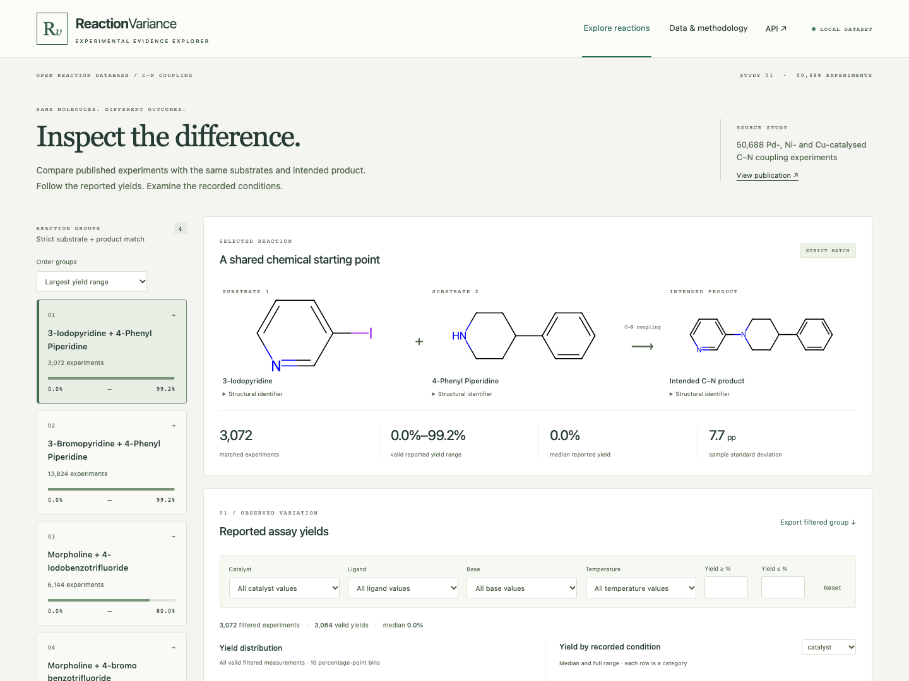
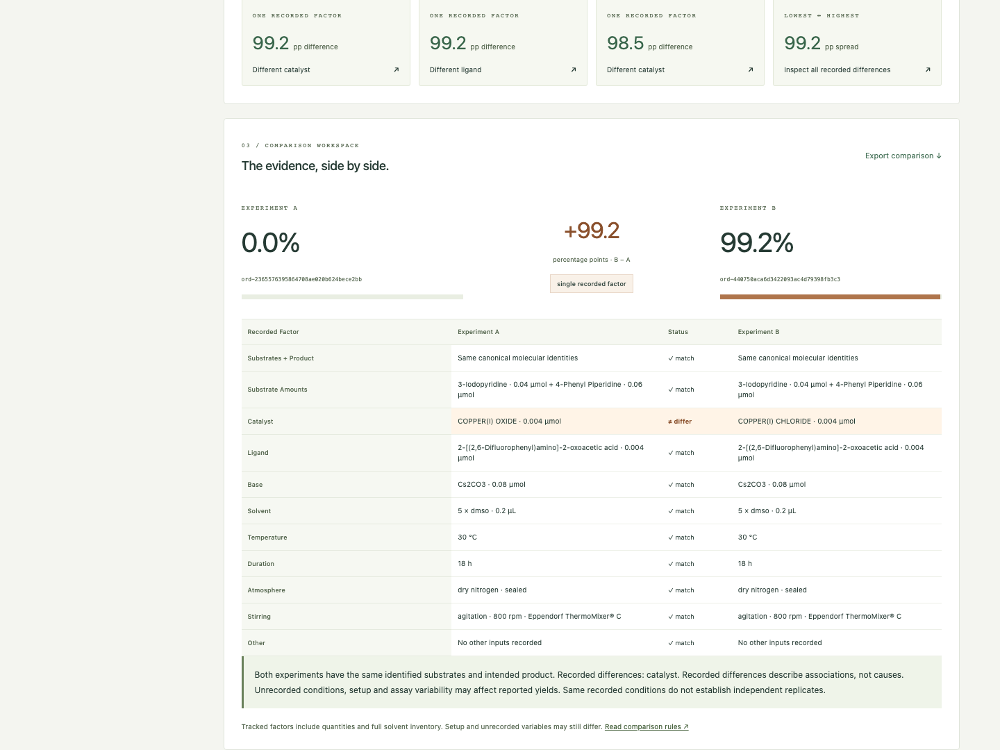

# ReactionVariance

A local scientific explorer for comparing published C–N coupling experiments with exactly the same identified substrates and intended product. Inspect how reported assay yields vary, then examine the recorded conditions side by side. The goal is transparent experimental comparison, with provenance and explicit limits on interpretation.



## What works

- One-time download and streaming ORD Parquet ingestion using `ord-schema`.
- RDKit canonical isomeric structure matching, with molecular SVG rendering.
- Four strictly matched substrate/product groups spanning 50,688 real records.
- Paginated experiment tables, condition/yield filters, and stable sorting.
- Filtered yield histograms and categorical median/full-range plots.
- Two-record comparison with matching, differing and unavailable factors.
- Efficient single recorded-factor contrasts and same-condition observations.
- Original IDs, measurements, quantities, source rows, quality flags and audit.
- Attributed group and comparison CSV exports; offline operation after setup.



## Run locally

Requirements: Python 3.12+, [uv](https://docs.astral.sh/uv/), Node.js 22+, and pnpm 12.3.4. No cloud accounts, keys, containers or GPU are required.

```sh
make install
make download        # only the specified ~5 MB ORD dataset
make inspect         # writes reports/data-audit.{md,json}
make ingest          # atomic rebuild of data/processed/reactions.sqlite
make backend         # terminal 1: http://127.0.0.1:8011
make frontend        # terminal 2: http://127.0.0.1:5173
```

Open [the explorer](http://127.0.0.1:5173). Port 8011 is used for the backend to avoid the commonly occupied port 8000. Vite proxies API requests locally. The interface shows setup instructions when the database is missing.

For a production build served entirely by FastAPI:

```sh
make build
make serve
# Open http://127.0.0.1:8011
```

The source and database are ignored under `data/`. `make rebuild` regenerates the database and audit from the cached source without downloading again. `make download` reuses an existing source file and prints its SHA-256. Delete only `data/raw/source.parquet` to explicitly fetch a new snapshot; compare checksums and regenerate the audit before interpreting changes. To use a separate database, export `REACTION_DB=/absolute/path/file.sqlite` before starting the server. No `.env` loader or configuration file is required.

## The actual data

Source: Open Reaction Database dataset
`ord_dataset-805ad863feef48579d95d86a728035f4`, from
[_A 50,688-Reaction Data Set Reveals General Ligands and Mechanistic Diversity
in C–N Couplings_](https://doi.org/10.1021/jacs.6c05959).
[Original Parquet file](https://huggingface.co/datasets/open-reaction-database/ord-data/blob/main/data/80/ord_dataset-805ad863feef48579d95d86a728035f4.parquet).

| Audited property                    |           Result |
| ----------------------------------- | ---------------: |
| Source records / distinct IDs       |  50,688 / 50,688 |
| Strict substrate/product groups     |                4 |
| Valid primary assay yields          |           50,668 |
| Preserved zero yields               |           36,433 |
| Flagged out-of-range yields         |               20 |
| Source yield range, including flags |     0–147.37291% |
| Reaction-time coverage              | 50,688; all 18 h |
| Temperature values                  |    30, 60, 80 °C |

All records enter strict groups; flagged measurements remain inspectable but never enter valid-yield summaries. The source contains only four substrate combinations, not a full cross-product of the advertised two amines and four aryl halides. Read the [generated data audit](reports/data-audit.md), [machine-readable provenance](reports/data-audit.json), and [extraction/matching policy](docs/methodology.md).

## A real comparison

Group `13b15046267b1b7e2a0e`: **3-iodopyridine + 4-phenylpiperidine**, with the same identified intended C–N product.

| Recorded factor             | Experiment A                                   | Experiment B                           |
| --------------------------- | ---------------------------------------------- | -------------------------------------- |
| ORD ID                      | `ord-2365576395864708ae020b624bece2bb`         | `ord-440750aca6d3422093ac4d79398fb3c3` |
| Reported assay yield        | 0%                                             | 99.18171%                              |
| Catalyst                    | copper(I) oxide, 0.004 µmol                    | copper(I) chloride, 0.004 µmol         |
| Ligand                      | 2-[(2,6-difluorophenyl)amino]-2-oxoacetic acid | same                                   |
| Base                        | Cs2CO3                                         | same                                   |
| Solvent                     | recorded DMSO inventory                        | same                                   |
| Temperature / reaction time | 30 °C / 18 h                                   | same                                   |

The recorded difference is the catalyst factor. Other tracked factors and quantities match. The difference is **99.18171 percentage points**, with LCMS analytical yield measurements from calibration curves. This does not establish that the catalyst caused the difference. Unrecorded factors and assay variability may contribute. Full provenance is saved in [the verified comparison](reports/verified-comparison.json). Paste the two IDs into `/api/compare?reaction_ids=ID_A,ID_B`, or open the first suggested contrast in the first group.

## Scientific rules and limitations

Only explicit core REACTANT structures and a unique desired product enter a strict group. Salts, charges, isotopes and stereochemistry are retained. Dataset-specific input names **and** custom role codes distinguish ligands, metal catalysts and bases. Ingredient order never determines roles.

Only desired-product percentage YIELD measurements qualify. AREA is not yield. All measurements are preserved; primary selection prefers latest known reaction time, authentic-standard calibration, then source position. Conflicting same-time yields are flagged and excluded. Unknown never means zero or none. Explicit absence requires an explicit source code.

Tracked factors include substrate and component quantities, full solvent inventory, temperature, duration, atmosphere, stirring and other recorded inputs. A missing factor makes comparison incomplete. Component quantities retain original units, so equivalent quantities expressed differently can conservatively appear different. Setup and unrecorded variables are not controlled by this matching policy. A single recorded-factor contrast is not necessarily a controlled experiment. Same-condition observations are not asserted to be independent replicates, and yield spread alone does not quantify reproducibility.

Assay yields are not necessarily isolated preparative yields. This tool makes descriptive comparisons; it offers no predictions, synthesis recommendations, statistical confidence score or causal conclusions. It is deliberately scoped to one dataset. Extreme candidate contrasts can reflect assay variability; inspect the actual records before interpreting them.

## Architecture and API

Python/FastAPI + pandas + RDKit + ord-schema → indexed SQLite → React/TypeScript, Vite, Tailwind and Recharts. Import is atomic and separate from API requests. The API does not reparse source Protobufs. Pagination caps tables at 100 records; charts aggregate all filtered valid measurements server-side. Single-factor candidate lookup uses leave-one-factor-out signatures rather than all pairs. The local database occupies approximately 500 MB and runs comfortably without external infrastructure. Code lives under `backend/app` and `frontend/src`.

[OpenAPI UI](http://127.0.0.1:8011/docs) describes health, dataset, groups, reactions, comparisons, insights, distributions, structures, and exports.

```sh
curl 'http://127.0.0.1:8011/api/groups?sort=spread&limit=4'
curl 'http://127.0.0.1:8011/api/groups/13b15046267b1b7e2a0e/reactions?yield_min=30&limit=10'
curl 'http://127.0.0.1:8011/api/compare?reaction_ids=ord-2365576395864708ae020b624bece2bb,ord-440750aca6d3422093ac4d79398fb3c3'
```

## Verification

```sh
make test             # chemistry, units, yields, comparisons, API, frontend
make build            # TypeScript checking and production bundle
pnpm --dir frontend exec playwright install chromium  # once for browser tests
# With backend + frontend running:
make e2e              # real-data desktop + mobile workflows and screenshots
make format
```

Tests separate synthetic scientific edge cases from actual-dataset integration checks. Synthetic fixtures never enter the application database. Integration tests skip explicitly if no database exists; run ingestion before full verification. E2E tests block nonlocal requests, verify group selection, filters, empty states, selection, single-factor highlights, CSV contents, responsive width, automated accessibility checks, and screenshots in `docs/`. GitHub Actions is configured to download/import before integration tests; hosted CI has not been run.

Future work could add validated quantity-unit equivalence, richer source batch metadata, and more precise time-series measurement inspection. Arbitrary uploads, optimization, prediction and additional reaction families remain outside this MVP.

## Licenses and attribution

Application code: [MIT](LICENSE). The upstream ORD dataset is CC-BY-SA-4.0; consult the [ORD license and attribution terms](https://creativecommons.org/licenses/by-sa/4.0/) when redistributing source or derived data. Generated audits, comparison exports, and source-derived records retain dataset attribution and licensing information. The code license does not change the dataset license. Source URL, DOI, checksum, parser/package versions, and import timestamp are recorded in the audit.
